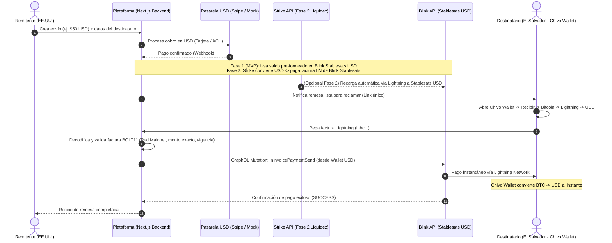

# Plataforma Fullstack de Remesas con Bitcoin & Lightning (EE.UU. $\rightarrow$ El Salvador)
**Documento de Arquitectura, Análisis de Proveedores, Montos Mínimos y Estrategia de Entornos**

---

## 1. Resumen Ejecutivo y Visión

El objetivo de este proyecto es construir una plataforma **Fullstack** que permita a cualquier persona en el mundo (iniciando por **Estados Unidos** como primer mercado) enviar remesas hacia **El Salvador** de forma instantánea y con comisiones mínimas, utilizando **Bitcoin y la red Lightning** de manera transparente por detrás.

### Propuesta de Valor
1. **Sin volatilidad para el negocio ni para el usuario:** Los fondos en tránsito se resguardan en **Stablesats (saldo sintético en USD)** dentro de **Blink**, manteniendo paridad 1:1 con el dólar estadounidense hasta el momento exacto del retiro.
2. **Recepción en dólares reales en El Salvador:** El destinatario genera una factura Lightning en su **Chivo Wallet** configurada para recibir en **USD**. Cuando nuestra plataforma paga esa factura con Bitcoin vía Lightning, Chivo Wallet liquida automáticamente a dólares estadounidenses en la cuenta del receptor.
3. **Velocidad y bajo costo:** Liquidación en menos de 3 segundos sobre Lightning Network con costos de red inferiores a una fracción de centavo.

---

## 2. Arquitectura del Flujo de la Remesa

### Detalle del Flujo por Etapas

1. **Origen (EE.UU.):**
   * El remitente ingresa el monto en USD a enviar y los datos del beneficiario en El Salvador.
   * Se realiza el cobro en USD (simulado durante el desarrollo inicial o mediante **Stripe** en producción).
2. **Resguardo en Dólares sobre Bitcoin (Blink Stablesats):**
   * **En el MVP (Fase 1):** Operamos con un fondo de tesorería pre-fondeado directamente en nuestra cuenta **Stablesats (USD)** de **Blink**. Así las remesas se procesan al instante sin depender de los días de liquidación bancaria (ACH/Stripe) ni de retiros individuales desde un exchange.
   * **En Escalamiento (Fase 2):** Integramos **Strike API** para que, a medida que entran dólares en EE.UU., nuestro backend genere una factura en USD desde Blink (`lnUsdInvoiceCreate`) y la pague automáticamente desde nuestro balance USD en Strike (`POST /v1/payment-quotes/lightning`), reabasteciendo Stablesats en 1 segundo.
3. **Reclamo y Liquidación (El Salvador - Chivo Wallet):**
   * El destinatario recibe un enlace/código de cobro.
   * En su **Chivo Wallet**, entra a **Recibir $\rightarrow$ Bitcoin $\rightarrow$ Lightning $\rightarrow$ Recibir en USD**, digita el monto exacto que le indica nuestra plataforma y copia la factura (`lnbc...`).
   * Nuestro backend **decodifica la factura `bolt11`** antes de enviar un solo satoshi para verificar:
     * Que sea una factura **Lightning válida de Mainnet** (`lnbc...`) y no una dirección On-Chain (`bc1...`).
     * Que el monto codificado en la factura coincida con el monto neto a recibir.
     * Que la factura no haya expirado.
   * Una vez validada, nuestro backend llama a la API GraphQL de Blink (`lnInvoicePaymentSend`) usando el `walletId` de nuestra cuenta **USD (Stablesats)**.
   * Chivo Wallet recibe el pago y acredita **USD** al instante al destinatario.

---

## 3. Análisis de Proveedores para Comprar Bitcoin por API

> [!IMPORTANT]
> **Por qué el proveedor debe soportar Lightning Network por API:**
> Si se comprara Bitcoin en un exchange tradicional y se enviara a Blink mediante la red **On-Chain**, cada retiro tardaría entre 10 y 60 minutos y costaría entre \$2 y \$15 USD en comisiones de red/retiro. Al usar **Lightning Network**, el traslado hacia Blink Stablesats tarda ~1 segundo y cuesta cerca de \$0.00 USD.

### Tabla Comparativa de Proveedores

| Proveedor | Soporte API Compra + Envío Lightning | Mínimo de Compra / Envío | Ventajas Clave | Limitaciones / Consideraciones |
| :--- | :--- | :--- | :--- | :--- |
| **Strike API** *(Seleccionado para Fase 2)* | **Sí, nativo** (`POST /v1/payment-quotes/lightning`) | **\$0.01 USD** | Permite mantener USD y pagar directamente facturas Lightning de Blink Stablesats sin fee de retiro de Strike. | Para uso comercial en producción requiere cuenta **Strike Business (KYB)** (aunque permite generar API Key en cuenta personal verificada para pruebas). |
| **Kraken API** *(Alternativa Exchange Grande)* | **Sí** (`AddOrder` + `Withdraw` método Lightning) | Compra: **`0.0001 BTC`** (~\$7 - \$9 USD) Retiro LN: **`0.00001 BTC`** (~\$0.80 USD) | Exchange de alta liquidez, regulado en EE.UU., ideal para compras por lotes grandes (tesorería). | **Seguridad de Whitelist:** Kraken exige pre-aprobar destinos de retiro. Como las facturas Lightning son de un solo uso, es mejor usarlo para recargas por lote y no por cada micro-remesa. |
| **Coinbase API** *(Advanced Trade)* | **Restringido por API** | Compra: **~\$1.00 - \$2.00 USD** | Fácil conexión bancaria en EE.UU. | Aunque la app soporta Lightning, los retiros automáticos sin intervención humana (2FA) por API requieren **Coinbase Prime** (institucional). |
| **Bitfinex API** | **Sí** (API v2 método `lnx`) | Compra: **~\$5.00 - \$9.00 USD** Retiro: **~\$5.00 USD** | Excelente API Lightning y presencia regulada en El Salvador. | **No disponible en EE.UU.** Bloquea usuarios, empresas y cuentas bancarias estadounidenses. |

---

## 4. Requerimientos Técnicos de las APIs

### A. Blink API (Activa y Lista para el MVP)
* **Protocolo:** GraphQL
* **Endpoint de Producción:** `https://api.blink.sv/graphql`
* **Endpoint de Staging (Signet):** `https://api.staging.blink.sv/graphql`
* **Autenticación:** Header HTTP `X-API-KEY: <tu_api_key_de_blink>`
* **Permisos (Scopes) requeridos en la API Key:**
  * `READ`: Para consultar los IDs de las billeteras (`BTC` y `USD`/Stablesats) y sus balances.
  * `RECEIVE`: Para generar facturas en USD (`lnUsdInvoiceCreate`) cuando recarguemos liquidez.
  * `WRITE`: Para pagar las facturas de Chivo Wallet (`lnInvoicePaymentSend`).
* **Operaciones GraphQL Principales que usaremos:**
  1. `me { defaultAccount { wallets { id walletCurrency balance } } }`: Obtiene el `walletId` donde `walletCurrency == "USD"` (nuestra billetera Stablesats).
  2. `lnInvoiceFeeProbe`: Estima la comisión de ruta Lightning antes de pagar.
  3. `lnInvoicePaymentSend`: Ejecuta el pago de la factura de Chivo Wallet descontando directamente de nuestro saldo en centavos de USD (Stablesats).

### B. Strike API (Para Fase 2 - Reabastecimiento Automático)
* **Protocolo:** REST JSON
* **Endpoint de Producción:** `https://api.strike.me/v1`
* **Autenticación:** Header HTTP `Authorization: Bearer <tu_api_key_de_strike>`
* **Requisitos de Cuenta:**
  * **Prototipo:** Cuenta personal verificada (KYC con documento de identidad en región soportada) y creación de API Key en `dashboard.strike.me`.
  * **Producción Comercial (KYB):** Cuenta *Strike Business* (requiere registro de empresa/EIN, documentos bancarios, identificación de propietarios beneficiarios y descripción del caso de uso).
* **Scopes requeridos en la API Key:**
  * `partner.balances.read` (leer saldo en USD/BTC)
  * `partner.rates.ticker` (consultar tipo de cambio)
  * `partner.payment-quotes.lightning.create` y `partner.payment-quotes.execute` (cotizar y pagar facturas Lightning hacia Blink)

---

## 5. Análisis de Montos Mínimos y Límites

Para garantizar que podamos hacer pruebas en producción con montos muy pequeños sin bloqueos:

| Eslabón del Flujo | Monto Mínimo Permitido | Unidad en API / Sistema | Observaciones Prácticas |
| :--- | :--- | :--- | :--- |
| **Blink (Stablesats USD)** | **\$0.01 USD** (1 centavo) | Enteros en centavos (`100` = \$1.00 USD) | Permite recibir y enviar pagos desde 1 centavo de dólar por Lightning. |
| **Blink (Billetera BTC)** | **1 satoshi** (~\$0.001 USD) | Enteros en satoshis (`1` = 1 sat) | Sin mínimo práctico en red Lightning. |
| **Chivo Wallet (Recibir USD vía Lightning)** | **\$0.01 USD** | Factura BOLT11 (`lnbc...`) | Permite generar facturas de prueba de **\$0.25, \$0.50 o \$1.00 USD** sin problema y las convierte a USD al recibir. |
| **Strike API (Compra / Envío LN)** | **\$0.01 USD** | Decimal string (`"1.00"`) | Soporta micro-transacciones desde 1 centavo. |
| **Kraken API (Compra Spot `XBTUSD`)** | **`0.0001 BTC`** (~\$7 - \$9 USD) | Decimal BTC (`"0.0001"`) | Si se usa Kraken en el futuro, la orden mínima de compra ronda los \$7-\$9 USD. |
| **Stripe (Cobro con Tarjeta en EE.UU.)** | **\$0.50 USD** | Enteros en centavos (`50` = \$0.50 USD) | Stripe exige un cobro mínimo de \$0.50 USD por transacción procesada. |

> [!WARNING]
> **Validación Crítica para Chivo Wallet (Lightning vs. On-Chain):**
> En la interfaz de Chivo Wallet, cuando el usuario entra a *Recibir Bitcoin*, debe seleccionar explícitamente la opción **Lightning** y moneda **USD**. Si por error copia la dirección **On-Chain** (que empieza con `bc1...` o `3...`), los mínimos de red son altos y la confirmación es lenta. Nuestro sistema validará automáticamente que el texto ingresado sea una factura Lightning (`lnbc...`) y mostrará una guía visual paso a paso al destinatario en El Salvador.

---

## 6. Estrategia de Entornos: Dev vs. Producción

### Situación de los Entornos de Terceros
1. **Chivo Wallet:** **No tiene entorno de pruebas (Dev/Testnet)** ni API pública; opera exclusivamente sobre **Bitcoin Mainnet (Producción)**.
2. **Blink API:** Cuenta con un entorno Staging (`https://api.staging.blink.sv/graphql`) sobre la red *Bitcoin Signet*, pero **los fondos y facturas de Signet (`lntbs...`) son criptográficamente incompatibles con las facturas de producción de Chivo Wallet (`lnbc...`)**.

### Estrategia Híbrida Aprobada
Implementaremos un interruptor de entorno en nuestro backend (`PAYMENT_MODE` en `.env`):

1. **Modo Desarrollo Local (`PAYMENT_MODE=mock`):**
   * Simula el cobro en USD y simula las respuestas de Blink API validando de verdad el formato de las facturas Lightning.
   * Permite programar y probar todo el frontend, base de datos, estados de la remesa y paneles de usuario a **costo \$0.00**.
2. **Modo Producción con Micro-Montos (`PAYMENT_MODE=production`):**
   * Conecta directamente a `https://api.blink.sv/graphql` usando tu API Key de producción de Blink.
   * Las pruebas reales de punta a punta (Blink Stablesats $\rightarrow$ Chivo Wallet) se harán con **micro-montos de \$0.25 a \$1.00 USD**.
   * Dado que el envío es por Lightning hacia tu propia Chivo Wallet de prueba, **el dinero no se pierde** (llega a tu Chivo Wallet en USD) y el costo de red por prueba es de **\$0.00 a \$0.005 USD** (menos de medio centavo).

---

## 7. Stack Tecnológico y Arquitectura del Software

* **Framework Fullstack:** **Next.js (App Router)** con **TypeScript** (Frontend + API Routes / Server Actions en un solo repositorio limpio y tipado).
* **Estilos y UI:** **Tailwind CSS** + componentes modernos enfocados en confianza financiera y simplicidad móvil (vital para quien reclama la remesa desde su celular en El Salvador).
* **Base de Datos y ORM:** **PostgreSQL** gestionado con **Prisma ORM** (compatible con Supabase, Neon o PostgreSQL local).
* **Integraciones y Librerías Clave:**
  * **Cliente Blink GraphQL:** Servicio dedicado en el servidor (`src/lib/blink.ts`) para consultar balances en Stablesats, cotizar fees y pagar facturas `bolt11`.
  * **Validador BOLT11 (`light-bolt11-decoder`):** Para inspeccionar la factura pegada por el usuario de Chivo Wallet (extraer monto en satoshis/milisatoshis, fecha de expiración y red `bc` Mainnet) antes de autorizar el pago.
  * **Pasarela de Pago USD:** Modo simulado para el MVP + preparación para **Stripe Checkout / Payment Intents**.

---

## 8. Plan de Acción (Roadmap del MVP)

1. **Fase 1.1 — Inicialización y Conexión con Blink API:**
   * Inicializar el proyecto Next.js + TypeScript + Tailwind + Prisma.
   * Crear el módulo de conexión con **Blink GraphQL API** y verificar mediante un script/endpoint de diagnóstico que tu API Key lee correctamente tu billetera `BTC` y tu billetera `USD` (Stablesats).
2. **Fase 1.2 — Modelo de Datos de Remesas:**
   * Crear las tablas para `Remittance` (estado: `PENDING_PAYMENT`, `READY_TO_CLAIM`, `PROCESSING_PAYOUT`, `COMPLETED`, `FAILED`), auditoría de pagos y tasas de cambio.
3. **Fase 1.3 — Flujo del Remitente (EE.UU.):**
   * Calculadora de envío en tiempo real (mostrando monto enviado, comisión transparente y monto exacto en USD que recibirá en Chivo Wallet).
   * Pantalla de pago (con modo prueba instantáneo y estructura lista para Stripe) que genera el link/código de cobro.
4. **Fase 1.4 — Flujo del Destinatario (El Salvador - Chivo Wallet):**
   * Vista móvil guiada paso a paso para generar la factura en USD dentro de Chivo Wallet.
   * Validador de factura `bolt11` en tiempo real + desembolso instantáneo desde Blink Stablesats USD.
5. **Fase 1.5 — Panel de Administración / Tesorería:**
   * Dashboard para ver el saldo disponible en tu cuenta Blink (Stablesats USD y BTC), historial de remesas y botón para generar facturas de recarga de Stablesats.
