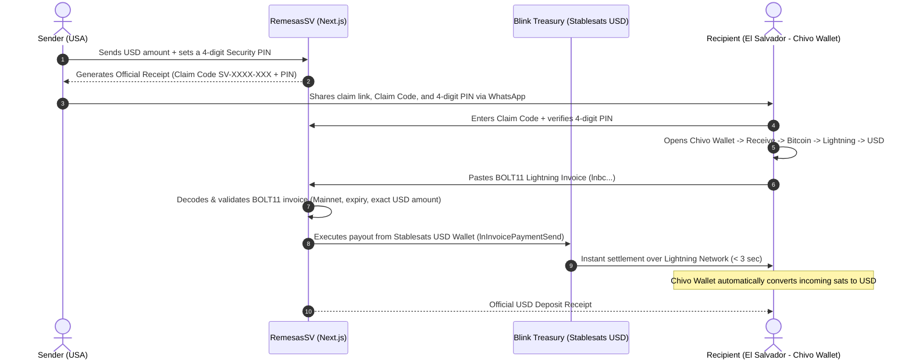

# ⚡ RemesasSV — Fullstack Instant USD Remittances to El Salvador

**RemesasSV** is a fullstack web platform that enables anyone in the United States (or worldwide) to send USD remittances to **El Salvador** in seconds with near-zero fees, powered behind the scenes by **Bitcoin and the Lightning Network**.

---

## 🎯 The Problem

Cross-border remittances to El Salvador represent billions of dollars annually, yet everyday users still face three major pain points:
1. **High Fees:** Traditional remittance providers charge **5% to 10%** on smaller transfers, taking a significant cut from working families.
2. **Slow Settlement:** Bank transfers take multiple business days or require recipients to wait in physical lines to pick up cash.
3. **Crypto Volatility & Complexity:** While Bitcoin is legal tender in El Salvador and **Chivo Wallet** is widely adopted, senders and recipients want to send and receive **US Dollars (USD)** without worrying about Bitcoin price fluctuations while the transfer is in transit.

---

## 💡 The Solution (How It Works)

RemesasSV abstracts away all Bitcoin complexity to deliver a seamless, 100% USD experience for both the sender and the recipient:



1. **Zero Volatility with Stablesats (USD):** Funds waiting to be claimed are held in a **Stablesats (synthetic USD)** wallet inside **Blink**, maintaining a 1:1 peg to the US Dollar until the exact moment the recipient claims the transfer.
2. **Real USD Payouts in Chivo Wallet:** The recipient in El Salvador generates a Lightning invoice inside **Chivo Wallet** configured to **receive in USD**. When our backend pays that invoice over the Lightning Network, Chivo Wallet automatically converts the incoming satoshis into **US Dollars** in the recipient's account.
3. **Two-Factor Claim Security (Claim Code + 4-Digit PIN):** To claim a remittance, the recipient must provide both the unique **Claim Code (`SV-XXXX-XXX`)** and the secret **4-digit PIN** chosen by the sender. After 5 failed PIN attempts, the remittance is automatically locked against brute-force attacks.

---

## ✨ Key Features

### 👥 Public Customer Platform (`/` & `/reclamar`)
* **Consumer-Grade UI:** Clean, trustworthy interface with zero crypto jargon or internal business details exposed.
* **Real-Time Remittance Calculator:** Transparent breakdown of the amount sent, applicable fee, and exact net USD amount the recipient will receive in El Salvador.
* **Digital Receipt & One-Click WhatsApp Share:** Generates a printable digital receipt and a pre-formatted WhatsApp message containing the claim link, Claim Code, and 4-digit PIN.
* **Smart Chivo Wallet Invoice Validator:** Automatically inspects pasted invoices (`bolt11`) to verify they are valid Mainnet Lightning invoices (`lnbc...`), warns users if they accidentally paste an On-Chain address (`bc1...`), checks expiration timestamps, and verifies that the invoice amount matches the remittance payout.

### 🔐 Private Admin & Treasury Dashboard (`/admin`)
* **Password-Protected Access:** Secured via an `httpOnly` session cookie.
* **Live Blink Treasury Monitoring:** Real-time balances for both the **Stablesats (USD)** wallet (in USD/cents) and the **Bitcoin (BTC)** wallet (in satoshis), plus live BTC/USD reference rates.
* **Hybrid Environment Switch (`MOCK` vs. `PRODUCTION`):** Toggle between the `$0` local simulator and live Mainnet production payouts with a single click.
* **Public Fee Control:** Switch between **$0.00 Fee (1:1 Promo/Test Mode)** (ideal for live micro-amount testing starting at `$0.10 USD`) and **Commercial Pricing (`1.5% + $0.50 USD`)**.
* **Remittance Audit Table & PIN Unlock:** Full history of all remittances, including claim status, 4-digit PINs, error logs, and a one-click button to unlock orders locked by failed PIN attempts.
* **Stablesats Liquidity Top-Up:** Built-in generator for USD-denominated Lightning invoices (`lnUsdInvoiceCreate`) to replenish the Blink Stablesats treasury.

---

## 🛠️ Tech Stack

* **Framework:** [Next.js 15](https://nextjs.org/) (App Router, Route Handlers) with **TypeScript**.
* **Styling & UI:** [Tailwind CSS](https://tailwindcss.com/) + [Lucide React](https://lucide.dev/) icons.
* **Bitcoin & Lightning Infrastructure:** [Blink GraphQL API](https://dev.blink.sv/) (`lnInvoicePaymentSend`, `lnUsdInvoiceCreate`, `lnInvoiceFeeProbe`).
* **BOLT11 Invoice Decoding:** [`light-bolt11-decoder`](https://www.npmjs.com/package/light-bolt11-decoder).
* **Persistence:** Zero-config local JSON transactional store (`data/remittances.json`) for instant local startup + [`prisma/schema.prisma`](./prisma/schema.prisma) schema ready for PostgreSQL / Supabase deployment.

---

## 🚀 Getting Started (Local Setup)

### 1. Prerequisites
* **Node.js** `v20+` (tested on `v24.16.0`) and **npm**.
* *(Optional for Production Mode)* A **[Blink](https://blink.sv/)** account and an **API Key** generated at [dashboard.blink.sv](https://dashboard.blink.sv/) with `READ`, `RECEIVE`, and `WRITE` scopes enabled.

### 2. Environment Variables
Copy `.env.example` to `.env` (if not already present):

```bash
cp .env.example .env
```

Available variables in `.env`:
```env
# "mock" for free local simulation | "production" for live Blink Mainnet payouts
PAYMENT_MODE="mock"

# Official Blink GraphQL API endpoint
BLINK_API_URL="https://api.blink.sv/graphql"

# Your Blink API Key (can also be configured directly via the /admin web panel)
BLINK_API_KEY=""

# Password to access the private admin dashboard at http://localhost:3000/admin
ADMIN_PASSWORD="admin1234"
```

### 3. Install Dependencies
```bash
npm install
```

### 4. (Optional) Run the Blink CLI Diagnostic Check
Verify at any time that your `BLINK_API_KEY` and your `USD` (Stablesats) and `BTC` wallets are responding properly:
```bash
npm run blink:check
```

### 5. Start the Development Server
```bash
npm run dev
```
Open your browser at **[http://localhost:3000](http://localhost:3000)**.

---

## 🧪 Quick End-to-End Testing Guide

1. **Configure Your Treasury in `/admin`:**
   * Go to **[http://localhost:3000/admin](http://localhost:3000/admin)** and log in using the default password: `admin1234`.
   * Select **Mock Mode ($0)** for simulated testing, or paste your `BLINK_API_KEY` and enable **Production Mode (Blink Mainnet)** to send real funds to Chivo Wallet.
2. **Send a Remittance as a Customer (`/`):**
   * Go to **[http://localhost:3000](http://localhost:3000)**.
   * Enter an amount (you can test in Production with micro-amounts like **`0.25`** or **`0.50`** USD), sender name, recipient name, and a **4-digit Security PIN**.
   * Click **Send** to generate your **Claim Code (`SV-XXXX-XXX`)** and digital receipt.
3. **Claim the Remittance in Chivo Wallet (`/reclamar`):**
   * Open the claim link or visit **[http://localhost:3000/reclamar](http://localhost:3000/reclamar)** and enter the Claim Code and **4-digit PIN**.
   * On your phone, open **Chivo Wallet** $\rightarrow$ **Receive** $\rightarrow$ **Bitcoin** $\rightarrow$ **Lightning** tab $\rightarrow$ **USD** currency, and enter the exact remittance USD amount.
   * Copy the generated Lightning invoice (`lnbc...`), paste it into the platform, and click **Receive USD in my Chivo Wallet Now**. Within 3 seconds, the dollars will appear in your Chivo Wallet balance!

---

## 📂 Project Structure

```text
├── prisma/
│   └── schema.prisma                     # PostgreSQL / Prisma database schema
├── scripts/
│   └── check-blink.ts                    # CLI diagnostic script (npm run blink:check)
├── src/
│   ├── app/
│   │   ├── api/
│   │   │   ├── admin/auth/route.ts       # Admin authentication via httpOnly cookie
│   │   │   ├── blink/status/route.ts     # Private Blink treasury & admin management API
│   │   │   ├── invoice/inspect/route.ts  # Public BOLT11 invoice decoder for live preview
│   │   │   └── remittances/              # REST endpoints for remittance creation, PIN check & payout
│   │   ├── admin/page.tsx                # Private Admin & Treasury Dashboard (/admin)
│   │   ├── enviar/page.tsx               # Dedicated Send Remittance page (/enviar)
│   │   ├── reclamar/
│   │   │   ├── page.tsx                  # Public Claim Code lookup (/reclamar)
│   │   │   └── [code]/page.tsx           # 4-digit PIN verification & Chivo Wallet payout page
│   │   └── page.tsx                      # Public customer landing & remittance calculator (/)
│   ├── components/
│   │   ├── Navbar.tsx                    # Customer-facing navigation bar
│   │   └── SendRemittanceSection.tsx     # Calculator, sender form, digital receipt & WhatsApp share
│   └── lib/
│       ├── admin-auth.ts                 # Server-side admin session verification
│       ├── blink.ts                      # Blink GraphQL client (Stablesats USD & BTC)
│       ├── bolt11.ts                     # BOLT11 Lightning invoice validator (lnbc...)
│       └── store.ts                      # Remittance state engine & brute-force PIN lock
├── ARQUITECTURA_Y_ANALISIS.md            # Technical architecture & exchange analysis document
└── README.md                             # Main project documentation
```
